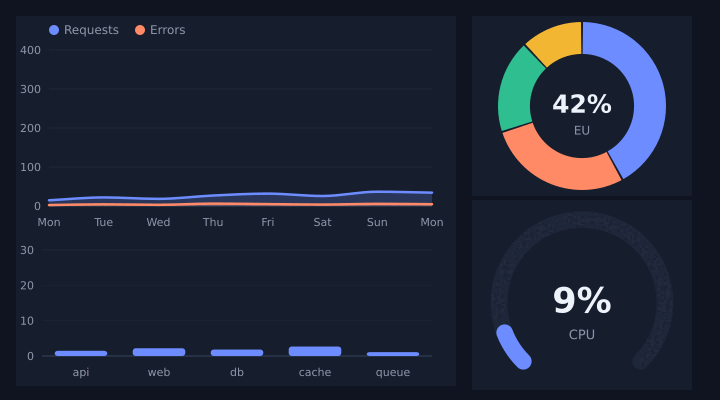

<div align="center">

# weaver-charts

### Charts that move when the data does.

Line, area, bar, sparkline, donut and gauge charts for Rust.
<br>
Output plain shapes for any renderer, or a ready SVG string. No dependencies.

</div>

<p align="center">
  
</p>
<p align="center"><sub>Every frame is <code>Chart::to_svg</code> output; <code>AnimatedChart</code> springs the values between data sets. Regenerate with the command at the bottom.</sub></p>

## Quick start

```toml
[dependencies]
weaver-charts = { git = "https://github.com/maxmaster55/weaver-charts" }
```

```rust
use weaver_charts::{Chart, Theme};

let svg = Chart::area()
    .size(480.0, 240.0)
    .labels(["Mon", "Tue", "Wed", "Thu", "Fri"])
    .series("Requests", [120.0, 180.0, 150.0, 220.0, 260.0])
    .series("Errors", [4.0, 9.0, 3.0, 12.0, 6.0])
    .smooth(true)
    .to_svg_with(&Theme::dark());

std::fs::write("traffic.svg", svg)?;
# Ok::<(), std::io::Error>(())
```

## Every chart

| Builder | What you get |
| --- | --- |
| `Chart::line()` | Lines with a y axis, grid and labels. `.smooth(true)` curves them without overshooting; `.points(true)` adds dots. |
| `Chart::area()` | Filled areas; `.stacked(true)` stacks the series. |
| `Chart::bar()` | Grouped bars per label; `.stacked(true)` stacks them. |
| `Chart::sparkline(values)` | A tiny trend line with no axes, for tables and cards. |
| `Chart::donut().slice("EU", 42.0)...` | A ring with a headline for the biggest slice. |
| `Chart::gauge(72.0, 0.0, 100.0).unit("%")` | A 270° meter with the value in the middle. |

Common options: `.size(w, h)`, `.labels([...])`, `.y_range(min, max)`,
`.ticks(n)`, `.legend(false)`. Axis ticks land on round numbers
(`0, 20, 40...`) and long numbers shorten to `1.2k` / `3.4M`.

## Draw it yourself

`chart.shapes()` returns a `Vec<Shape>` of paths, rectangles, circles,
lines and text. Each shape has a `Role` (grid, axis, label, series *n*,
track, value) so your renderer decides the colours. `path_data(&cmds)`
gives the SVG `d` string if you want it, and `Theme` holds the colours the
built-in SVG writer uses (`Theme::light()`, `Theme::dark()`,
`.with_series([...])`).

## Animate data changes

With the `motion` feature, values spring to new data using the
[Weave motion engine](https://github.com/maxmaster55/weave-motion):

```toml
weaver-charts = { git = "https://github.com/maxmaster55/weaver-charts", features = ["motion"] }
```

```rust
use weaver_charts::{AnimatedChart, Chart};

let mut chart = AnimatedChart::grow_in(Chart::bar().series("Sales", [3.0, 5.0, 4.0]));

// When new data arrives:
chart.set_series(0, [6.0, 2.0, 8.0]);

// Every frame:
let still_moving = chart.advance(1.0 / 60.0);
let svg = chart.chart().to_svg();
```

`grow_in` makes bars and gauges rise from zero on first show. Changing the
data while a transition runs keeps each value's velocity, so live data
never stutters.

## Part of Weaver

`weaver-charts` is one of the [Weaver](https://github.com/maxmaster55) libraries.
[weaver-genui](https://github.com/maxmaster55/weaver_ui) uses it to draw
`chart` and `sparkline` nodes from live data, but it depends on none of
them.

## Regenerate the animation

```sh
cargo run --example readme --features motion -- /tmp/frames
convert -delay 3 -loop 0 /tmp/frames/*.svg -layers Optimize docs/dashboard.gif
```

ImageMagick needs an SVG delegate such as `rsvg-convert`.

## License

MIT or Apache-2.0, at your option.
